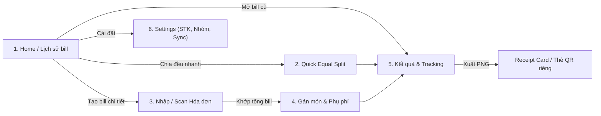
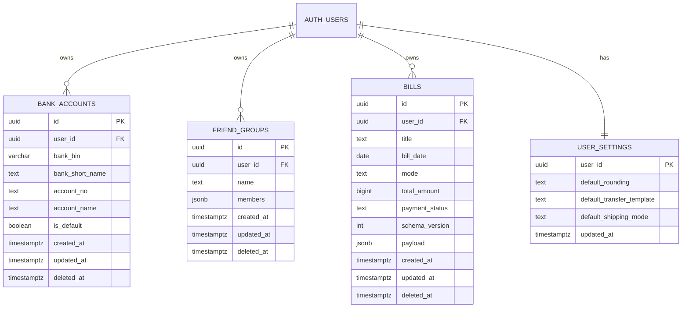

# Mâm — Đặc tả MVP v1.0 & Data Schema

> **Tên hiển thị:** Mâm (`mam`)  
> **Mục tiêu:** App chia bill cá nhân (Single-Player + VietQR Offline), đồng bộ 2 chiều **iOS ↔ Android**.  
> **Stack:** Flutter (Dart 3) + Supabase (PostgreSQL + Auth + 1 Edge Function proxy gọi Gemini 2.5 Flash).

---

## 1. Phạm vi MVP (v1.0)

| Trong phạm vi (v1.0) | Để sang v2.0 |
|---|---|
| Đăng nhập 1 tài khoản cá nhân, sync 2 chiều iOS ↔ Android (offline-first) | Nhiều người đứng ra trả tiền (multi-payer bù trừ chéo) |
| Chế độ **Chia đều siêu tốc** (nhập tổng tiền + số người → ra QR trong < 5 giây) | Đa ngoại tệ (du lịch nước ngoài) |
| Nhập bill bằng **Scan ảnh OCR (Gemini Flash qua Edge Function)** hoặc **Nhập tay** | Nhắc nợ tự động / đọc biến động số dư ngân hàng |
| **Thanh đối chiếu tổng OCR** (`Σ món + phí - giảm` vs `Tổng in trên bill`) | Static Web Viewer đọc link `#hash` |
| Gán món siêu tốc: chọn người → tap món, nút `Cả bàn`, `+/-` theo số lượng, long-press chọn nhóm con | Chia sẻ đa tài khoản / phát hành public |
| Phụ phí & giảm giá: VAT + Phí phục vụ (pro-rata), Ship (chọn Chia đều / Pro-rata), Giảm giá riêng từng món & toàn bill | |
| Đánh dấu **Chủ xị ("Tôi")** → tự động tick `Đã trả`, không tạo QR tự chuyển | |
| Làm tròn `1.000đ` (`Không` / `Gần nhất` / `Làm tròn lên`) + hiển thị minh bạch chênh lệch | |
| Sinh **VietQR động 100% offline** (chuẩn EMVCo NAPAS 247) + xuất ảnh PNG chia sẻ Zalo/Messenger | |
| Lưu lịch sử bill, lọc chưa thu đủ, tick `Đã trả` từng người | |

---

## 2. Luồng & 6 Màn hình chính



### 2.1. `HomeScreen` — Lịch sử & Tổng quan
- **Header:** Logo/tên **Mâm**, trạng thái đồng bộ (`Đã đồng bộ` / `Offline - chờ sync` / `Đang đồng bộ`), nút `Settings`.
- **Thẻ tóm tắt:** Tổng số tiền **chưa thu đủ** trên các bill có `payment_status = 'pending'`.
- **Danh sách bill:** Filter `Tất cả` | `Chưa thu đủ` | `Đã xong`. Mỗi item hiện: `title`, `bill_date`, `total_amount`, tiến độ `3/5 đã trả`. Vuốt để xóa mềm (`deleted_at`).
- **Hành động chính:** `+ Tạo bill mới` (vào `BillInputScreen`) và `Chia đều nhanh` (vào `QuickEqualScreen`).

### 2.2. `QuickEqualScreen` — Chia đều siêu tốc (< 5 giây)
- Nhập `Tên bữa ăn` (gợi ý tự động theo khung giờ + ngày, vd: *"Ăn trưa 22/11"*).
- Nhập `Tổng tiền` (VNĐ).
- Chọn nhanh danh sách người từ `FriendGroup` hoặc nhập nhanh tên / số lượng người (`Người 1, Người 2...`).
- Toggle đánh dấu **Chủ xị ("Tôi")** + chế độ làm tròn (`1.000đ`).
- Bấm **Tạo kết quả** → lưu bill với `mode = 'quick_equal'` (1 item ảo `"Tổng hóa đơn"` gán đều cả bàn) và chuyển thẳng sang `ResultScreen`.

### 2.3. `BillInputScreen` — Nhập & Scan Hóa đơn
- **Scan ảnh OCR:** Nút `Chụp ảnh` / `Chọn từ thư viện` → nén ảnh (`maxWidth: 1280`, JPEG ~75%) → gọi Edge Function `POST /functions/v1/scan-bill` → tự điền danh sách món & phụ phí.
- **Nhập tay / Sửa inline:** Danh sách dòng món `[Tên món | SL | Thành tiền | Giảm giá riêng (optional)]`, nút `+ Thêm món`.
- **Phụ phí & Giảm giá toàn bill:**
  - `VAT` (nhập `%` hoặc số tiền VNĐ — quy đổi ra `taxAmount`)
  - `Phí phục vụ` (nhập `%` hoặc VNĐ — quy đổi ra `serviceChargeAmount`)
  - `Tiền ship` (`shippingAmount`) kèm toggle `Chia đều (flat)` / `Theo tỷ lệ (pro_rata)`
  - `Giảm giá toàn bill` (`billDiscountAmount`)
- **Thanh đối chiếu tổng (Reconciliation Bar):**
  - Tính `computedTotal = Σ(lineTotal - itemDiscount) + taxAmount + serviceChargeAmount + shippingAmount - billDiscountAmount`.
  - Nếu có `ocrGrandTotal` và `computedTotal != ocrGrandTotal` → tô đỏ hiển thị `Lệch +/- X đ so với tổng in trên bill` để người dùng sửa đúng dòng OCR sai trước khi sang bước gán món.

### 2.4. `SplitAssignScreen` — Gán món siêu tốc
- **Sticky Top Bar (Người tham gia):** Danh sách chip tên người (mỗi người 1 màu nhẹ, badge `Tôi` cho chủ xị) + nút `+` thêm tên nhanh hoặc load từ `FriendGroup`.
- **Cơ chế gán 2 chiều tối ưu tốc độ:**
  1. **Tap theo người (mặc định):** Chọn 1 người ở thanh trên → chạm liên tiếp vào các món người đó ăn để toggle `shares[personId]`.
  2. **Số lượng > 1:** Khi món có `quantity > 1` (vd: 3 ly trà sữa), hiện stepper `- / +` ngay trên dòng món để gán đúng số phần cho người đang chọn.
  3. **Nút `Cả bàn`:** 1 chạm để gán đều (`weight = 1`) cho tất cả người tham gia.
  4. **Long-press món:** Mở bottom sheet multi-select chọn nhanh nhóm con (vd: 4/8 người chung nồi lẩu).
- **Guard món chưa gán:** Thanh đáy màn hình báo rõ `Còn X món (Y đ) chưa gán` (những món có `shares` rỗng hoặc tổng weight `<= 0`). Chặn bấm `Xem kết quả` hoặc yêu cầu xác nhận khi vẫn còn món chưa gán.

### 2.5. `ResultScreen` — Kết quả, VietQR & Tracking
- **Tài khoản nhận tiền:** Chọn từ `bank_accounts` (mặc định tài khoản `is_default = true`), lưu snapshot vào `payload.bankAccountSnapshot` để giữ nguyên lịch sử khi đổi STK sau này.
- **Tùy chọn làm tròn:** `Không` | `Gần nhất 1.000đ` | `Làm tròn lên 1.000đ`. Nếu có sai số làm tròn → hiện rõ dòng: *"Chênh lệch làm tròn: Chủ xị bù -1.200đ"* (hoặc *"+800đ"*).
- **Danh sách từng người:**
  - Tên, badge `Tôi`, chi tiết các món đã ăn (expandable), **Số tiền cuối cùng**.
  - Nút **Tick `Đã trả`** (chủ xị tự động `paid = true`; khi tất cả `paid = true` → cập nhật `payment_status = 'settled'`).
  - Nút **QR riêng** (chỉ hiện cho người không phải chủ xị và `amount > 0`).
- **Xuất ảnh PNG chia sẻ Zalo/Messenger (`RepaintBoundary` + `share_plus`):**
  1. **Receipt Card tổng hợp:** Layout giống tờ hóa đơn thật — tên quán, ngày, chi tiết ai ăn gì, bảng tổng tiền từng người, chênh lệch làm tròn (nếu có), và 1 mã VietQR tĩnh của chủ xị.
  2. **Thẻ QR riêng cho 1 người:** Tóm tắt ngắn phần của người đó + **VietQR động đã điền sẵn đúng số tiền + nội dung CK không dấu**.

### 2.6. `SettingsScreen` — Cài đặt cá nhân
- **Tài khoản ngân hàng:** Thêm/sửa/xóa mềm, chọn ngân hàng từ danh sách BIN 6 số offline (`bank_bins.json`), đặt 1 tài khoản mặc định.
- **Nhóm bạn hay đi ăn:** Tạo/sửa/xóa mềm các nhóm quen (*Team Công ty*, *Hội bạn thân*...).
- **Mặc định tính toán:** Chế độ làm tròn mặc định, cách chia tiền ship mặc định (`flat` / `pro_rata`), mẫu nội dung chuyển khoản (`{name} tra tien {title}`).
- **Tài khoản & Đồng bộ:** Email đang đăng nhập, thời điểm sync gần nhất, nút `Đồng bộ ngay`, nút `Đăng xuất`.

### 2.7. Bộ thư viện Flutter tối giản đề xuất
- `supabase_flutter` — Auth, Postgres sync, gọi Edge Function
- `sqflite` + `shared_preferences` — Local-first cache & `pendingSyncQueue`
- `image_picker` + `flutter_image_compress` — Chụp/chọn & nén ảnh trước khi OCR
- `qr_flutter` — Render mã VietQR vector sắc nét
- `share_plus` + `path_provider` + `RepaintBoundary` (built-in) — Xuất PNG & chia sẻ Zalo/Messenger

---

## 3. Quy tắc Tính toán & VietQR Offline

### 3.1. Công thức tính tiền từng người

Với mỗi món $k$ có `lineTotal`, `itemDiscount`, và bản đồ gán phần ăn `shares`:
- Giá trị ròng của món: $V_k = \max(0,\; \text{lineTotal}_k - \text{itemDiscount}_k)$.
- Tổng trọng số của món: $W_k = \sum_{j} \text{shares}_k[j]$. Nếu $W_k = 0$ → món thuộc danh sách **chưa gán**.
- Tiền món người $i$ chịu:
  $$M_i = \sum_{k:\; W_k > 0} V_k \times \frac{\text{shares}_k[i]}{W_k}$$
- Tổng tiền món đã gán: $S = \sum_i M_i$. *(Guard: nếu $S = 0$, không thực hiện phép chia pro-rata → phần pro-rata bằng 0).*

Phân bổ phụ phí & giảm giá:
- **Tổng pro-rata ròng:**
  $$P_{\text{net}} = \text{taxAmount} + \text{serviceChargeAmount} + \text{ship}_{\text{pro\_rata}} - \text{billDiscountAmount}$$
  $$\text{ProRata}_i = \begin{cases} M_i \times \dfrac{P_{\text{net}}}{S} & \text{nếu } S > 0 \\ 0 & \text{nếu } S = 0 \end{cases}$$
- **Tổng chia đều đầu người** (với $N$ người tham gia có phần ăn hoặc tất cả người trong bill nếu `quick_equal`; guard $N > 0$):
  $$\text{Flat}_i = \frac{\text{ship}_{\text{flat}}}{N}$$
- **Tiền gốc trước làm tròn:**
  $$\text{Raw}_i = \max(0,\; M_i + \text{ProRata}_i + \text{Flat}_i)$$
- **Làm tròn theo `roundingMode`:**
  - `none`: `Raw_i.round()`
  - `nearest_1000`: `(Raw_i / 1000).round() * 1000`
  - `ceil_1000`: `(Raw_i / 1000).ceil() * 1000`
- **Chênh lệch làm tròn hiển thị minh bạch:**
  $$\Delta_{\text{rounding}} = \left(\sum_i \text{Final}_i\right) - \text{ComputedGrandTotal}$$

### 3.2. Chuẩn sinh chuỗi VietQR Offline (EMVCo NAPAS 247)

Bản chất VietQR là chuỗi ghép các trường `ID (2 ký tự) + Length (2 chữ số, zero-padded) + Value`, kết thúc bằng mã kiểm tra `CRC16-CCITT-FALSE`:

| Tag | Ý nghĩa | Giá trị chuẩn |
|---|---|---|
| `00` | Payload Format Indicator | `01` |
| `01` | Point of Initiation Method | `12` (Động — khi `amount > 0`), `11` (Tĩnh — khi không có số tiền) |
| `38` | Merchant Account Info (NAPAS) | Ghép 3 subtag: `00` = `A000000727`, `01` = (`00`: `bankBin` 6 số + `01`: `accountNo`), `02` = `QRIBFTTA` |
| `53` | Transaction Currency | `704` (VNĐ) |
| `54` | Transaction Amount | Số nguyên dương dạng chuỗi (vd: `"125000"`). **Bỏ qua tag này** nếu tạo QR tĩnh |
| `58` | Country Code | `VN` |
| `62` | Additional Data Field | Subtag `08` = nội dung chuyển khoản **đã chuẩn hóa** |
| `63` | CRC Checksum | `6304` + 4 ký tự hex **viết hoa** tính bằng `CRC16-CCITT-FALSE` (poly `0x1021`, init `0xFFFF`) trên toàn bộ chuỗi tính cả `6304` |

**Quy tắc chuẩn hóa nội dung chuyển khoản (`Tag 62/08`):**
1. Bỏ toàn bộ dấu tiếng Việt (`đ/Đ` → `d/D`, chuẩn hóa NFD bỏ combining marks).
2. Chỉ giữ ký tự `[A-Za-z0-9 ]`, gộp nhiều khoảng trắng liên tiếp thành 1, trim 2 đầu.
3. Cắt tối đa **25 ký tự** (mặc định an toàn cho mọi app ngân hàng VN; tối đa kỹ thuật 50 ký tự).

**Ví dụ mã BIN ngân hàng phổ biến (nhúng trong `bank_bins.json`):**
`970436` (Vietcombank), `970407` (Techcombank), `970422` (MB Bank), `970418` (BIDV), `970415` (VietinBank), `970416` (ACB), `970423` (TPBank), `970432` (VPBank), `970405` (Agribank), `970403` (Sacombank), `970441` (VIB), `970448` (OCB).

---

## 4. Data Schema & Sync Architecture

### 4.1. Entity-Relationship Diagram



### 4.2. Source of Truth của Schema
- **Database Migration (PostgreSQL + RLS + Triggers):** xem [supabase/migrations/001_init.sql](../supabase/migrations/001_init.sql).
- **Flutter Domain Models (Pure Dart 3):** xem [app/lib/models/bill_models.dart](../app/lib/models/bill_models.dart).
- **Quy ước đặt tên:**
  - Cột bảng SQL: `snake_case` (`bill_date`, `total_amount`, `updated_at`, `deleted_at`).
  - Trường trong `bills.payload` (JSONB), `friend_groups.members` (JSONB), và OCR Response JSON: `camelCase` (`lineTotal`, `itemDiscount`, `shippingMode`, `bankAccountSnapshot`).

### 4.3. Hợp đồng OCR Edge Function (`POST /functions/v1/scan-bill`)

- **Bảo mật:** Bắt buộc gửi `Authorization: Bearer <supabase_access_token>`. Edge Function verify JWT bằng `supabase.auth.getUser()`, chỉ dùng `GEMINI_API_KEY` từ server env.
- **Request JSON:**
```json
{
  "imageBase64": "<jpeg_base64_compressed_max_1280px>",
  "mimeType": "image/jpeg"
}
```
- **Response JSON (`200 OK`):**
```json
{
  "title": "Lẩu Haidilao",
  "billDate": "2026-11-22",
  "items": [
    { "name": "Nước lẩu cà chua", "quantity": 1, "lineTotal": 120000, "itemDiscount": 0 },
    { "name": "Trà sữa", "quantity": 3, "lineTotal": 135000, "itemDiscount": 0 }
  ],
  "taxAmount": 20400,
  "serviceChargeAmount": 12750,
  "shippingAmount": 0,
  "billDiscountAmount": 30000,
  "ocrGrandTotal": 258150,
  "confidence": "high"
}
```
- **Lỗi chuẩn:** `401 Unauthorized` (JWT sai/hết hạn), `400 Bad Request` (ảnh rỗng/quá lớn > 2MB), `502 Bad Gateway` (Gemini lỗi/timeout → app fallback thông báo nhẹ & cho nhập tay).

### 4.4. Cơ chế Sync 2 chiều iOS ↔ Android (Offline-First)

1. **Local-first:** Mọi đọc/ghi chạy thẳng xuống SQLite local trước → UI phản hồi tức thì, dùng bình thường khi mất mạng (trong quán ăn tầng hầm).
2. **Pull Delta:** Khi mở app hoặc pull-to-refresh, kéo các bản ghi có `updated_at > lastSyncedAt` từ 4 bảng (`bills`, `bank_accounts`, `friend_groups`, `user_settings`).
3. **Conflict Resolution (Last-Write-Wins):** Vì chỉ có 1 người dùng cá nhân trên 2 máy, merge theo `id` dựa vào `updated_at` mới hơn. Bản ghi có `deleted_at != null` sẽ bị ẩn khỏi UI trên cả 2 máy.
4. **Push Queue:** Mỗi thao tác tạo/sửa/tick `Đã trả`/xóa mềm ghi vào `pending_sync_queue` local và gọi `upsert` lên Supabase; nếu đang offline thì giữ trong queue và tự retry khi có mạng.

---

## 5. Lộ trình Thực thi (7 Bước Nhỏ)

1. **Bước 1 (Hiện tại):** Chốt đặc tả MVP (`docs/mvp-spec.md`) + SQL migration (`001_init.sql`) + Dart models (`bill_models.dart`).
2. **Bước 2:** Khởi tạo Flutter project (`mam`) + viết `calculator.dart` & `vietqr.dart` + unit tests.
3. **Bước 3:** Xây dựng 5 màn hình offline (`Home`, `Settings`, `QuickEqual`, `BillInput`, `SplitAssign`) + SQLite local.
4. **Bước 4:** Xây dựng `ResultScreen` + `ReceiptCard` + xuất ảnh PNG & test quét VietQR thực tế trên app ngân hàng.
5. **Bước 5:** Thiết lập Supabase Auth (1 user) + `sync_service.dart` đồng bộ iOS ↔ Android.
6. **Bước 6:** Deploy Edge Function `/scan-bill` + nối chụp ảnh OCR ở `BillInputScreen`.
7. **Bước 7:** Build & cài thực tế trên máy Android & iOS cá nhân.
